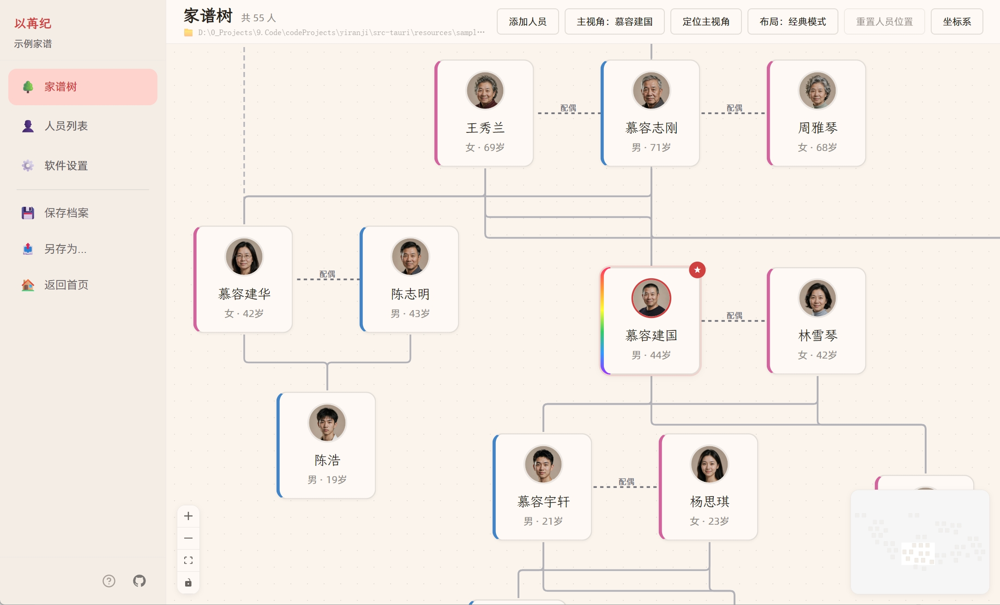

# 以苒纪 (yiranji)

> **光阴在苒，世家成纪。**

"以苒纪"取自"光阴在苒，世家成纪"——以苒（时光流转）为纪，记录家族世代的延续与传承。

这是一款现代化的家谱管理桌面应用，基于 Tauri v2 + React 构建，支持人员档案管理、家族树可视化、农历转换等功能。数据保存在本地，并可通过 WebDAV 在多设备间同步家谱。

## 预览

### 首页

### 家族树

### 个人信息

## 下载与安装

前往 [Releases](https://github.com/hcllmsx/yiranji/releases/latest) 页面获取最新版本。安装包通过百度网盘 / 夸克网盘分发，发布页内附有下载二维码，扫码转存后下载 `以苒纪_v<版本>_x64-setup.exe` 直接运行安装即可（当前仅提供 Windows 版）。

## 使用方法

1. 启动后在欢迎页**新建家谱工程**，或点击**体验示例**直接打开内置的示例家谱；
2. 在**人员**页录入家族成员档案（头像、生卒日期、出生地、农历等），在**家族树**页查看并调整世系与亲属关系；
3. 家谱工程以文件夹形式保存在本地磁盘，可在**设置**页的**多设备同步**中填写 WebDAV 地址（如 Nextcloud、坚果云、自建服务），实现多设备备份与恢复。

## 功能特性

- **人员档案** — 支持头像、生卒日期、出生地、生肖、农历等信息管理
- **家族树** — 可视化展示家族关系，支持经典树状与同辈齐平双布局、缩放、拖拽与节点交互
- **农历支持** — 自动计算农历日期与生肖
- **行政区划联动** — 内置全国省/市/县/乡镇四级数据
- **多设备同步** — 基于 WebDAV 的云端备份与恢复，可一键关闭
- **本地存储** — 数据加密保存在本地，纯单机模式下不产生任何网络请求

## 致谢

- **行政区划数据** — 来自 [xiangyuecn/AreaCity-JsSpider-StatsGov](https://github.com/xiangyuecn/AreaCity-JsSpider-StatsGov)，包含省/市/县/乡镇四级数据
- **农历转换** — [lunar-javascript](https://github.com/6tail/lunar-javascript)
- **字体** — [霞鹜文楷](https://github.com/lxgw/LxgwWenKai) · [阿里巴巴普惠体](https://fonts.alibabagroup.com/)
- **图片压缩** — 导出图片（JPG/PNG）的编解码基于 Google [Squoosh](https://github.com/GoogleChromeLabs/squoosh) 项目的 WASM 编解码器（经 [jSquash](https://github.com/jamsinclair/jSquash) 封装），底层使用 [MozJPEG](https://github.com/mozilla/mozjpeg) 与 [Oxipng](https://github.com/oxipng/oxipng)

## 开源许可

本项目基于 [GPL-3.0](./LICENSE) 协议开源，版权所有 © 2026 莫莫先生。

- 作者：莫莫先生 · [B站主页](https://space.bilibili.com/255947051)
- 问题反馈：[意见反馈表](https://docs.qq.com/form/page/DRHJ3bmd6Q3RqaENT)